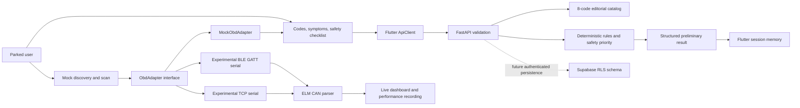

# AutoSense architecture

Flutter uses Material 3 and a small injected API client. State belongs to each screen;
home holds temporary result history. Make/model/year menus remain optional, with
model selection reset when make changes. Mock scans can auto-fill a simulated
vehicle identity; they never infer a car from DTCs. Clearing is supported only on
the mock adapter, after confirmation, and does not remove saved session results.
The frontend HP/torque calculator uses known inputs and shaft-power equations;
it does not measure engine output or estimate it from scanner data.
A single request/result model serves manual, mock, BLE and Wi-Fi input.
Physical source labels are client-supplied provenance, not server verification. A mock scan prefills the same form, so the user reviews the safety
checklist before submitting. Leaving the scan screen disconnects the mock adapter.

FastAPI exposes `GET /health`, `GET /v1/dtc/{code}`, and `POST /v1/diagnostics`.
The backend is stateless and does not save requests or results. Unknown valid DTCs
return `found:false` and no invented definition. Invalid codes return 422. Inputs
are bounded (20 codes, 2,000 characters of notes). Vehicle fields are context only.
The API uses a fixed rule engine (`rules-v1`), without an LLM or external calls.
Its hypotheses are unranked; no probabilities or accuracy claims are attached.

Priority is selected safety flag → `stop_safely`; otherwise missing safety review
or any free-text note → `unassessed`; otherwise a P030x code → `urgent`; otherwise
→ `inspection`. None of these states is permission to drive. A user can submit
without completing the checklist; the result explicitly remains unassessed.
Free-text content is accepted for context, but is never automatically interpreted.

## Supabase boundary

The SQL provides `profiles`, `vehicles`, `diagnostic_sessions`, `diagnostic_results`,
and a generic `dtc_catalog`. Every private table has authenticated owner policies.
Composite foreign keys stop users linking their session to someone else's vehicle
or result to someone else's session. Indexes support owner/history access. Deleting
an Auth user cascades their private data; deleting a session cascades its result.
Delete referencing sessions before deleting a vehicle. Profiles require explicit
creation after sign-in; there is no automatic signup trigger.

This starter has **no Supabase connection, signup/login screen, or durable history**.
The migration is a ready starting point for those features, not an implied working
integration. Owner-writable result JSON is personal history, not trusted evidence.
Before treating persisted results as authoritative, restrict result writes to a
verified backend path and validate every stored object against the API schema.

Next integration: add Supabase Auth → attach access token to API requests → verify
JWT signature, issuer, audience and expiry against the project JWKS → derive user
ID from that token → use the user's token with the Supabase REST API so RLS applies.
Do not accept a client-supplied owner ID as identity. Never put service-role keys in
Flutter. A service-role backend bypasses RLS and needs separate ownership checks.
Add user-controlled retention and deletion, authenticated rate limits, and HTTPS
before exposing this local unauthenticated demo on the Internet.

## Contract and extension points

- `backend/app/catalog.py`: add reviewed code descriptions; record sources and licensing.
- `backend/app/diagnostics.py`: add reviewed rules, tests and a new engine version.
- `mobile/lib/services/obd_adapter.dart`: scanner/live-data interfaces.
- `mobile/lib/services/elm_protocol.dart`: bounded ELM commands and CAN assembly.
- `mobile/lib/services/ble_obd_adapter.dart`: native BLE, automatic documented UART matching and ELM identity verification.
- `mobile/lib/services/wifi_obd_adapter.dart`: native TCP serial transport.
- `mobile/lib/models/performance_run.dart`: kinetic-energy estimate and quality gates.
- `scripts/export_contracts.py`: regenerate OpenAPI, Flutter fixture and SQL seed.
- `docs/openapi.json`: machine-readable API contract for client generation later.

An optional future LLM may explain a validated structured result. It must not
override the safety priority, invent manufacturer code definitions, or provide
unverified repairs. Add consent, strict output validation and cost caps first.

Live telemetry and performance runs stay local and never reach the diagnostic API.
The second SQL migration adds BLE/Wi-Fi source labels. The connected menu owns the
BLE session; returning from its dashboard waits for reads and preserves connection.
Backgrounding/leaving the menu disconnects. Polling is serial and stale recording data is rejected. See README
for the equation and measurement limitations.
